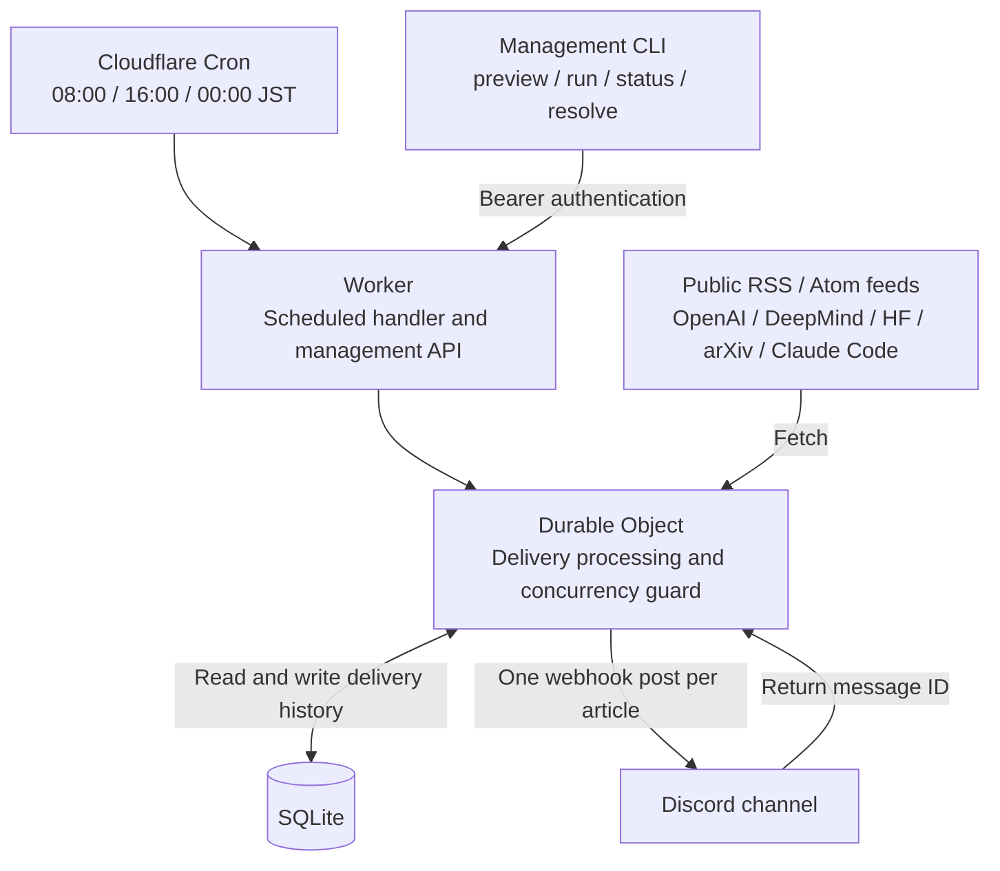

# AI News Discord

**English** | [日本語](README.ja.md)


Collect updates about AI agents and large language models from public feeds and post them to Discord at **08:00, 16:00, and 00:00 Japan Standard Time (JST)** every day.
The service runs on Cloudflare, so you do not need to keep a computer running.

Each run posts up to five articles, with one message per article containing its title, summary, and link.
Message headings are in Japanese; titles and summaries stay in the source language. Articles without summaries include a link to the full article.
The service does not use an LLM API for translation or summarization.

- [Architecture](#architecture)
- [Example Discord message](#example-discord-message)
- [Running costs](#running-costs)
- [Local preview and checks](#local-preview-and-checks)
- [Initial setup](#initial-setup)
- [Configuration](#configuration)
- [Manual operations and monitoring](#manual-operations-and-monitoring)
- [Delivery failures and recovery](#delivery-failures-and-recovery)
- [Repository layout](#repository-layout)
- [GitHub workflow](#github-workflow)

## Architecture



A Durable Object, Cloudflare's stateful execution unit, handles collection, delivery, and history updates.
Its built-in SQLite database stores delivery history, so there is no separate database to set up.
One Worker serves one destination, and scheduled runs and manual operations share the same history.

1. Load article URLs that have already been sent or are awaiting confirmation.
2. Fetch public feeds in parallel and select relevant AI agent and LLM articles from the last 48 hours.
3. Rank them by keywords and source priority, selecting up to two articles per source and five overall.
4. Save each article as `pending`, then post articles to Discord one at a time.
5. Mark an article as `sent` after confirming the message ID returned by Discord.

URLs are normalized to treat tracking parameters and arXiv version numbers as the same article.
If there are no new eligible articles, nothing is posted.
Ranking uses keywords. Collection is limited to the configured public feeds and does not cover the entire web or social media.
arXiv includes research that has not been peer reviewed, and recent revisions can also be selected based on their update timestamps.

Sources are defined in [src/sources.ts](src/sources.ts).

| Source | Feed |
| --- | --- |
| OpenAI News | News RSS |
| Google DeepMind | Blog RSS |
| Hugging Face | Blog RSS |
| arXiv | cs.AI / cs.CL paper feed |
| Claude Code | GitHub Releases Atom |

## Example Discord message

This example uses a fictional article. Each article becomes one message; `(1/3)` means the first of three articles in that run.
The Japanese heading below matches the actual output.

```text
AI エージェント / LLM 更新 — 2026/10/03 (1/3)

Example agent model with tool calling
Example AI Blog | 10/03 07:30 JST
A sample release describing new tool calling capabilities for AI agents.
<https://example.org/agent-release>
```

Titles and summaries remain in their original language. Summaries are trimmed to at most 350 characters, and mentions and link previews are suppressed.
If some feeds fail, their names are appended to the messages.

## Running costs

Based on official pricing checked on **2026-10-03**. Actual costs depend on your account's plan and total usage.

| Item | Pricing |
| --- | --- |
| Workers Free + SQLite Durable Objects | Free within each service's included limits. Exceeding Free limits causes operation errors rather than additional charges. |
| Workers Paid | Minimum USD 5 per month for the account. Durable Objects usage allowances are included; usage beyond the allowances is billed separately. |
| LLM API | Not used by this service, so there are no LLM API charges. |

SQLite Durable Objects Free allowances include 100,000 requests per day, five million rows read per day, 100,000 rows written per day, and 5 GB of total storage.
Execution duration also has an allowance; see [Durable Objects pricing](https://developers.cloudflare.com/durable-objects/platform/pricing/) for details.
See [Workers pricing](https://developers.cloudflare.com/workers/platform/pricing/) for the account subscription and Workers allowances.

This Worker runs three times a day and posts at most 15 articles per day.
Normal use of this service alone is expected to fit comfortably within Free allowances, but other applications on the same account also consume those allowances.
Check your current plan and usage in the Cloudflare Dashboard.

## Local preview and checks

Use Node.js **24.15.0** and pnpm **11.21.0**.
Both versions are pinned in [.mise.toml](.mise.toml) and [ci.yml](.github/workflows/ci.yml).
Run commands from the repository root after setting up Node and pnpm.

If you use mise shell integration, trust the configuration and install only the two required tools:

```sh
mise trust .mise.toml
mise install node@24.15.0 pnpm@11.21.0
```

If you do not use mise, install the same versions with your preferred tools.

```sh
pnpm install --frozen-lockfile
pnpm preview
```

`pnpm preview` fetches current public feeds and prints candidate messages.
It does not post to Discord or update history, and requires no Cloudflare login or secrets.
This local preview has no access to production delivery history and uses fixed limits of five articles and 48 hours.
To see what production would actually deliver, use `pnpm control ... preview` as described below.

```sh
pnpm check
pnpm test
pnpm exec wrangler deploy --dry-run
```

Worker tests run in the Workers runtime with SQLite, using mocked feeds and Discord requests.
Management CLI tests use a local mock HTTP server.
Neither test suite posts to a real Discord channel.

## Initial setup

### 1. Create a Discord webhook

In Discord, open **Server Settings → Integrations → Webhooks**, create a webhook, and select the destination channel.
You need the server's **Manage Webhooks** permission.
Copy the webhook URL into the secrets file described in the next step.
To set the sender's avatar, change the image beside the webhook name and use the [project icon](assets/ai-news-icon.png).

### 2. Prepare secrets

From the repository root, create `.secrets.json` from the empty example and generate a random management token.
The token is written directly to the file and is not printed to the terminal.
If you already have a secrets file, use it instead of running this command.

```sh
node --input-type=module -e '
import { randomBytes } from "node:crypto";
import { readFileSync, writeFileSync } from "node:fs";
const settings = JSON.parse(readFileSync(".secrets.example.json", "utf8"));
settings.ADMIN_TOKEN = randomBytes(32).toString("hex");
writeFileSync(".secrets.json", JSON.stringify(settings, null, 2) + "\n", { flag: "wx", mode: 0o600 });
'
```

Open `.secrets.json` in an editor and set `DISCORD_WEBHOOK_URL` to the URL you copied.
Keep the generated `ADMIN_TOKEN`.

| Key | Purpose |
| --- | --- |
| `DISCORD_WEBHOOK_URL` | The actual Discord destination URL: `https://discord.com/api/webhooks/...` |
| `ADMIN_TOKEN` | Authenticates manual preview, delivery, status checks, and recovery. |

`.secrets.json` is excluded from Git.
Only the empty [.secrets.example.json](.secrets.example.json) is committed.
Keep secret values out of `wrangler.jsonc` and README files.

### 3. Log in to Cloudflare and deploy

```sh
pnpm exec wrangler login
pnpm exec wrangler whoami
pnpm run deploy --secrets-file .secrets.json
```

These commands deploy the Worker, Cron trigger, and SQLite Durable Object, and upload the secrets together with the code.
Cron cannot deliver messages without secrets, so include `--secrets-file` on the first deployment.
The deployment output provides the Worker URL: `https://ai-news-discord.<subdomain>.workers.dev`.
If you have multiple Cloudflare accounts, set the target `account_id` in `wrangler.jsonc` before deploying.
When updating an existing Worker with the same name, check the account and configuration first.

### 4. Preview production candidates

Replace `YOUR-SUBDOMAIN` with the subdomain from the deployment output.

```sh
curl https://ai-news-discord.YOUR-SUBDOMAIN.workers.dev/health
pnpm control https://ai-news-discord.YOUR-SUBDOMAIN.workers.dev preview
pnpm control https://ai-news-discord.YOUR-SUBDOMAIN.workers.dev status
```

`webhookConfigured: true` from `/health` only indicates that a webhook value is configured.
It does not validate the URL, management token, or delivery success.
Review the preview first. To send the initial batch immediately, run the command below. **This posts real messages to Discord.**

```sh
pnpm control https://ai-news-discord.YOUR-SUBDOMAIN.workers.dev run
```

Cloudflare Cron handles subsequent scheduled runs.
Cron configuration changes can take time to propagate. See [Cloudflare Cron triggers](https://developers.cloudflare.com/workers/configuration/cron-triggers/).

## Configuration

Non-secret settings live in [wrangler.jsonc](wrangler.jsonc) and `src/`.
After changes, regenerate types, run checks, and redeploy.

| Setting | Location | Default / range |
| --- | --- | --- |
| Maximum articles per run | `wrangler.jsonc` → `vars.ARTICLE_LIMIT` | `5`, range 1–10 |
| Article lookback window | `wrangler.jsonc` → `vars.LOOKBACK_HOURS` | `48` hours, range 1–168 |
| Delivery schedule | `wrangler.jsonc` → `triggers.crons` | `0 7,15,23 * * *` |
| Sources and source priorities | `src/sources.ts` | Five configured feeds |
| Topic keywords and per-source limit | `src/feeds.ts` → `score()` / `select()` | Two articles per source per run |
| Message format | `src/discord.ts` → `message()` | Japanese heading with the original title and summary |

Cron expressions use UTC. The default schedule maps to JST as follows:

| JST | UTC |
| --- | --- |
| 08:00 | 23:00 on the previous day |
| 16:00 | 07:00 |
| 00:00 on the next day | 15:00 |

If you change the schedule, also update the `schedule` display returned by `/health` in `src/index.ts`.

```sh
pnpm types
pnpm check
pnpm test
pnpm exec wrangler deploy --dry-run
pnpm run deploy
```

A normal `pnpm run deploy` preserves previously registered secrets.
To update secrets as well, deploy the updated file with `pnpm run deploy --secrets-file .secrets.json`.
Before changing an existing Worker's `name`, Durable Object class or instance name, or migration history, check the effect on delivery history.
A different Worker or Durable Object may start without the old history and send previously delivered articles again.

## Manual operations and monitoring

The management CLI reads `ADMIN_TOKEN` from `.secrets.json` and uses Bearer authentication to access the Worker.
You do not need to put the token in command-line arguments.

| CLI action | HTTP API | Behavior |
| --- | --- | --- |
| `preview` | `POST /preview` | Preview candidates using production settings and history; no posting or history updates. |
| `run` | `POST /run` | Deliver eligible articles to Discord. |
| `status` | `GET /status` | Return the running flag, total pending count, and latest 100 history entries. |
| `resolve-sent <article URL>` | `POST /resolve` | Mark a pending article as sent. |
| `resolve-not-sent <article URL>` | `POST /resolve` | Mark a pending article as not sent, making it eligible for a later retry. |

Only `GET /health` is unauthenticated.
The body for `POST /resolve` is `{"url":"article URL","outcome":"sent"}` or `{"url":"article URL","outcome":"not_sent"}`.

If you store secrets outside the repository, specify the file location without moving it:

```sh
AI_NEWS_SECRETS_FILE=/absolute/path/to/secrets.json pnpm control https://ai-news-discord.YOUR-SUBDOMAIN.workers.dev status
```

The `ADMIN_TOKEN` environment variable takes precedence over the file if set.

View execution logs in the Cloudflare Dashboard's Worker Logs, or run:

```sh
pnpm exec wrangler tail
```

For local management API development, copy `.dev.vars.example` to `.dev.vars`, enter the secrets, and run `pnpm dev`.
Local history is stored under `.wrangler/` and is separate from production history.
Local `run` calls and scheduled-handler tests can post to the configured webhook, so use a development channel.

## Delivery failures and recovery

History states determine whether an article can be sent on a later run.

| State | Meaning | Next run |
| --- | --- | --- |
| `sent` | Discord's message ID was confirmed, or delivery was manually confirmed. | Do not resend. |
| `pending` | Saved before posting; the delivery result has not been confirmed. | Do not resend automatically. |
| `rejected` | Explicit rejection, or manually confirmed as not sent. | Retry if the article still meets selection criteria. |

For HTTP 429, delivery follows Discord's `retry_after`, with at most four attempts: one initial attempt and three retries. Each wait is capped at 60 seconds.
Explicit 3xx / 4xx rejections become `rejected`; connection failures, 5xx responses, or missing message IDs remain `pending`.
Redirects are not followed.
If one article fails to post, processing stops for the remaining articles in that run.
Partial feed failures do not stop collection; failure of every source aborts delivery.

If an article remains `pending`, compare `status` with the Discord channel before resolving it.
For confirmed delivery:

```sh
pnpm control https://ai-news-discord.YOUR-SUBDOMAIN.workers.dev resolve-sent https://example.org/article
```

For confirmed non-delivery:

```sh
pnpm control https://ai-news-discord.YOUR-SUBDOMAIN.workers.dev resolve-not-sent https://example.org/article
```

`resolve-not-sent` only changes the state to `rejected`; it does not post immediately.
The next `run` or Cron invocation can retry the article if its publication time is still inside the lookback window.
Resolution is refused while delivery is running or when the article is already `sent` or `rejected`.
This is not an exactly-once delivery guarantee. Confirm the result before resolving uncertain delivery or deleting history.

## Repository layout

```text
.
├── README.md                    English overview, setup, and operations
├── README.ja.md                 Japanese overview, setup, and operations
├── LICENSE                      MIT license
├── .mise.toml                   Pinned Node and pnpm versions
├── .github/workflows/ci.yml      Checks on GitHub push / pull request
├── .secrets.example.json        Empty secrets example for production and CLI
├── .dev.vars.example            Empty secrets example for the local Worker
├── wrangler.jsonc               Worker, Cron, and SQLite configuration
├── worker-configuration.d.ts    Types generated by pnpm types
├── package.json                 Commands and dependencies
├── pnpm-lock.yaml               Dependency lockfile
├── src/
│   ├── index.ts                 Management API, scheduled runs, and history
│   ├── sources.ts               Feed sources
│   ├── feeds.ts                 Feed collection, parsing, and selection
│   └── discord.ts               Message formatting and webhook delivery
├── scripts/
│   ├── preview.ts               Local preview without delivery history
│   └── control.ts               Production and local management API calls
└── tests/
    ├── worker.test.ts           Workers, SQLite, and Discord behavior
    ├── control.test.ts          Management CLI authentication and requests
    └── fixtures/                Mock configuration data
```

## GitHub workflow

This directory is the root of a standalone Git repository.
Commit `pnpm-lock.yaml`, `wrangler.jsonc`, and empty configuration examples. Actual secrets, `node_modules/`, and `.wrangler/` are excluded.

[GitHub Actions CI](.github/workflows/ci.yml) runs on push and pull requests: frozen dependency installation → type check → tests → Worker deployment dry-run.
It requires no Discord webhook or Cloudflare credentials.
Deployment is manual with `pnpm run deploy`.

If you have GitHub CLI installed and have not created a GitHub repository yet, create a private repository with:

```sh
gh auth login
gh repo create ai-news-discord --private --source . --remote origin --push
```

If the GitHub repository already exists and your local repository has no `origin`, add its URL and push:

```sh
git remote add origin git@github.com:YOUR-ACCOUNT/ai-news-discord.git
git push -u origin main
```

After the first push, check that `CI` succeeds in the GitHub Actions tab.
With GitHub CLI, list runs and inspect an individual run:

```sh
gh run list --workflow ci.yml --limit 5
gh run view RUN_ID
```

## License

[MIT](LICENSE). You may use, modify, and redistribute the software while retaining the copyright and license notices.

## Official documentation

- [Cloudflare Cron configuration and scheduling](https://developers.cloudflare.com/workers/configuration/cron-triggers/)
- [Cloudflare secrets and deployment together with code](https://developers.cloudflare.com/workers/configuration/secrets/)
- [Durable Object persistence and external requests](https://developers.cloudflare.com/durable-objects/best-practices/rules-of-durable-objects/)
- [Discord webhook creation and delivery confirmation](https://docs.discord.com/developers/resources/webhook)
- [Discord rate limits](https://docs.discord.com/developers/topics/rate-limits)
