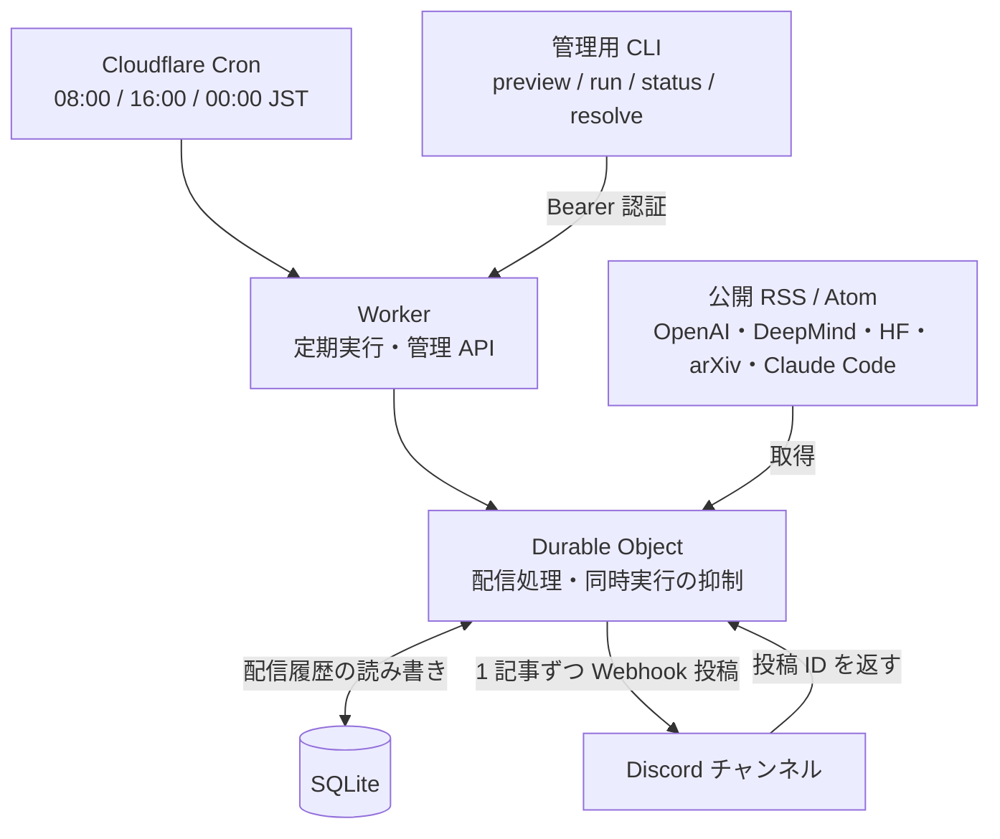

# AI News Discord


AI エージェント・LLM に関する公開フィードの更新を集め、毎日 **8:00・16:00・翌 0:00（日本時間）** に Discord へ配信する。
Cloudflare 上で実行するため、PC の常時起動は不要。

各回最大 5 件を、記事ごとに「タイトル・概要・リンク」の 1 メッセージとして投稿する。
見出しは日本語、記事のタイトルと概要は情報源の原文。概要がない記事はリンクを案内する。
LLM API による翻訳・要約は行わない。

- [仕組みの全体像](#仕組みの全体像)
- [Discord に届く通知例](#discord-に届く通知例)
- [運用費用](#運用費用)
- [まずローカルで確認する](#まずローカルで確認する)
- [初回セットアップ](#初回セットアップ)
- [設定の変更](#設定の変更)
- [手動操作と日々の確認](#手動操作と日々の確認)
- [投稿に失敗したとき](#投稿に失敗したとき)
- [ファイル構成](#ファイル構成)
- [GitHub での管理](#github-での管理)

## 仕組みの全体像



Durable Object（状態を保持する Cloudflare の実行単位）が、収集から投稿・履歴更新までを担当する。
履歴はその中の SQLite に保存し、外部データベースを別途用意する必要はない。
1 つの Worker で 1 つの配信先を扱い、定期実行と手動操作は同じ配信履歴を使う。

1. 前回までに送信済み・確認待ちとなった記事 URL を読み込む
2. 公開フィードを並列に取得し、直近 48 時間の AI エージェント・LLM 関連記事を選ぶ
3. キーワードと情報源の優先度で並べ、同じ情報源は最大 2 件、全体で最大 5 件に絞る
4. 記事の履歴を `pending` に保存してから、Discord に順番に投稿する
5. Discord が返した投稿 ID を確認できた記事を `sent` に更新する

同じ URL の記事は、追跡パラメーターや arXiv の版番号が違ってもまとめて扱う。
新しい対象記事がなければ投稿しない。
重要度の判定はキーワードによる順位付け。登録した公開フィードが対象で、Web・SNS 全体を収集する構成ではない。
arXiv は未査読の研究も含み、更新日時が新しい論文改訂も対象になる。

現在の情報源は [src/sources.ts](src/sources.ts) に定義している。

| 情報源 | 対象 |
| --- | --- |
| OpenAI News | ニュース RSS |
| Google DeepMind | ブログ RSS |
| Hugging Face | ブログ RSS |
| arXiv | cs.AI / cs.CL の論文フィード |
| Claude Code | GitHub Releases の Atom |

## Discord に届く通知例

架空の記事による表示例。1 記事が 1 メッセージになり、`(1/3)` はその回の 3 件中 1 件目を表す。

```text
AI エージェント / LLM 更新 — 2026/10/03 (1/3)

Example agent model with tool calling
Example AI Blog | 10/03 07:30 JST
A sample release describing new tool calling capabilities for AI agents.
<https://example.org/agent-release>
```

タイトルと概要は原文のまま。概要は最大 350 文字に整え、メンションとリンクのプレビュー表示を抑える。
情報源の取得が一部失敗した場合は、通知の末尾に取得できなかった情報源を付記する。

## 運用費用

2026-10-03 時点の公式料金に基づく。アカウントの契約プランと合計使用量で実際の費用が決まる。

| 項目 | 料金の考え方 |
| --- | --- |
| Workers Free + SQLite Durable Objects | それぞれの無料枠内なら無料。Free の上限超過は追加課金ではなく処理エラー |
| Workers Paid | アカウント全体で最低月 5 米ドル。Durable Objects の利用枠も含み、超過分は従量課金 |
| LLM API | この構成では使用しないため、LLM API の料金は発生しない |

SQLite Durable Objects の Free 枠には、1 日 10 万リクエスト、500 万行の読み込み、10 万行の書き込み、合計 5 GB の保存容量などがある。
実行時間にも無料枠があり、詳細は [Durable Objects の公式料金](https://developers.cloudflare.com/durable-objects/platform/pricing/) を参照する。
Workers の基本料金と無料枠は [Workers の公式料金](https://developers.cloudflare.com/workers/platform/pricing/) を参照する。

この Worker の定期実行は 1 日 3 回、Discord 投稿は最大 15 件。
単独の通常運用では Free の無料枠に十分収まる想定だが、同じアカウントの他のアプリの利用量も合算される。
現在の契約プランと使用量は Cloudflare Dashboard で確認する。

## まずローカルで確認する

Node.js **24.15.0** と pnpm **11.21.0** を推奨する。
両方のバージョンを [.mise.toml](.mise.toml) と [ci.yml](.github/workflows/ci.yml) に固定している。
Node・pnpm を用意し、リポジトリのルートで実行する。

mise のシェル連携を使う場合は、設定を信頼し、必要な 2 ツールだけを指定してインストールする。

```sh
mise trust .mise.toml
mise install node@24.15.0 pnpm@11.21.0
```

mise を使わない場合も、この 2 つのバージョンを用意する。

```sh
pnpm install --frozen-lockfile
pnpm preview
```

`pnpm preview` は現在の公開フィードから配信候補の文面を表示する。
Discord への投稿・履歴更新はせず、Cloudflare のログインや秘密設定も不要。
このローカルプレビューには本番の配信履歴がなく、件数・期間は 5 件・48 時間に固定している。
本番で実際に配信対象となる記事は、後述の `pnpm control ... preview` で確認する。

```sh
pnpm check
pnpm test
pnpm exec wrangler deploy --dry-run
```

Worker のテストは Workers ランタイムと SQLite を使い、外部フィードと Discord を模擬する。
管理 CLI のテストはローカルの模擬 HTTP サーバーを使う。
いずれも実際の Discord には投稿しない。

## 初回セットアップ

### 1. Discord の配信先を作る

Discord のサーバー設定 → 連携サービス → ウェブフックで Webhook を作成し、投稿先チャンネルを選ぶ。
作成にはサーバー側の「ウェブフックの管理」権限が必要になる。
Webhook URL をコピーして、次の秘密設定ファイルに保存する。
名前の横の画像を変更すると、通知の送信者アイコンを設定できる。[採用アイコン](assets/ai-news-icon.png)を使う。

### 2. 秘密設定を用意する

プロジェクトのルートで、空の設定例から `.secrets.json` を作り、管理用のランダムなトークンを生成する。
トークンはファイルに直接書き込み、端末には表示しない。
既にファイルを用意している場合は、この生成コマンドを実行せず既存の設定を使う。

```sh
node --input-type=module -e '
import { randomBytes } from "node:crypto";
import { readFileSync, writeFileSync } from "node:fs";
const settings = JSON.parse(readFileSync(".secrets.example.json", "utf8"));
settings.ADMIN_TOKEN = randomBytes(32).toString("hex");
writeFileSync(".secrets.json", JSON.stringify(settings, null, 2) + "\n", { flag: "wx", mode: 0o600 });
'
```

`.secrets.json` をエディターで開き、`DISCORD_WEBHOOK_URL` にコピーした URL を入力する。
生成した `ADMIN_TOKEN` はそのまま使う。

| キー | 用途 |
| --- | --- |
| `DISCORD_WEBHOOK_URL` | Discord の投稿先。`https://discord.com/api/webhooks/...` の実際の URL |
| `ADMIN_TOKEN` | 手動プレビュー・配信・履歴確認・復旧のための認証トークン |

`.secrets.json` は git 管理の対象外。
GitHub に保存するのは空の [.secrets.example.json](.secrets.example.json) のみ。
秘密の値は `wrangler.jsonc` や README に書かない。

### 3. Cloudflare にログインして配置する

```sh
pnpm exec wrangler login
pnpm exec wrangler whoami
pnpm run deploy --secrets-file .secrets.json
```

このコマンドで Worker・Cron・SQLite Durable Object を配置し、秘密設定も同時に登録する。
Cron は秘密設定なしでは投稿できないため、初回は `--secrets-file` を付ける。
配置後に表示される `https://ai-news-discord.<サブドメイン>.workers.dev` が Worker の URL になる。
Cloudflare アカウントが複数ある場合は、配置前に `wrangler.jsonc` の `account_id` で対象を指定する。
既存の同名 Worker を更新する場合は、そのアカウントと設定を確認する。

### 4. 本番の候補を確認する

以下の `YOUR-SUBDOMAIN` を配置時の出力に置き換える。

```sh
curl https://ai-news-discord.YOUR-SUBDOMAIN.workers.dev/health
pnpm control https://ai-news-discord.YOUR-SUBDOMAIN.workers.dev preview
pnpm control https://ai-news-discord.YOUR-SUBDOMAIN.workers.dev status
```

`/health` の `webhookConfigured: true` は Webhook の値が設定されていることだけを表す。
URL の有効性・管理トークン・配信成功を確認するものではない。
`preview` の候補を確認し、すぐに初回配信したい場合は次を実行する。この操作は **実際に Discord に投稿する**。

```sh
pnpm control https://ai-news-discord.YOUR-SUBDOMAIN.workers.dev run
```

以後は Cloudflare の Cron が定期実行する。
Cron 設定の反映には時間がかかることがある。[Cloudflare Cron の公式説明](https://developers.cloudflare.com/workers/configuration/cron-triggers/)

## 設定の変更

秘密以外の設定は [wrangler.jsonc](wrangler.jsonc) と `src/` で管理する。
変更後に型生成・チェックを行い、配置し直す。

| 変更したい内容 | 場所 | 初期値・範囲 |
| --- | --- | --- |
| 1 回の最大記事数 | `wrangler.jsonc` → `vars.ARTICLE_LIMIT` | `5`、1–10 |
| 何時間前までの記事を探すか | `wrangler.jsonc` → `vars.LOOKBACK_HOURS` | `48`、1–168 |
| 配信時刻 | `wrangler.jsonc` → `triggers.crons` | `0 7,15,23 * * *` |
| 情報源・情報源の優先度 | `src/sources.ts` | 登録済み 5 フィード |
| 関連キーワード・同じ情報源の上限 | `src/feeds.ts` → `score()` / `select()` | 同じ情報源は各回 2 件 |
| 通知の文面 | `src/discord.ts` → `message()` | 日本語の見出し＋原文のタイトル・概要 |

Cron の時刻は UTC。日本時間との対応は次のとおり。

| 日本時間 | UTC |
| --- | --- |
| 8:00 | 前日 23:00 |
| 16:00 | 7:00 |
| 翌 0:00 | 15:00 |

時刻を変更する場合は、`src/index.ts` の `/health` が返す `schedule` の表示も更新する。

```sh
pnpm types
pnpm check
pnpm test
pnpm exec wrangler deploy --dry-run
pnpm run deploy
```

通常の `pnpm run deploy` は既に登録した秘密設定を保持する。
秘密設定も変更する場合は、更新したファイルを `pnpm run deploy --secrets-file .secrets.json` で登録する。
既存運用の `name`、Durable Object のクラス名・名前・移行履歴を変える場合は、配信履歴への影響を確認する。
別の Worker や別の Durable Object になると履歴を引き継がず、同じ記事を再通知する可能性がある。

## 手動操作と日々の確認

管理 CLI は `.secrets.json` の `ADMIN_TOKEN` を読み、Bearer 認証（管理トークンを使う認証）で Worker にアクセスする。
トークンをコマンド引数に書く必要はない。

| CLI の操作 | HTTP API | 動作 |
| --- | --- | --- |
| `preview` | `POST /preview` | 本番の履歴・設定を使って候補を表示。投稿・履歴更新なし |
| `run` | `POST /run` | 候補を実際に Discord に配信 |
| `status` | `GET /status` | 実行中フラグ・確認待ちの総数・最新 100 件の履歴 |
| `resolve-sent <記事 URL>` | `POST /resolve` | 確認待ちの記事を送信済みにする |
| `resolve-not-sent <記事 URL>` | `POST /resolve` | 確認待ちの記事を未送信として再試行対象にする |

認証不要の API は `GET /health` のみ。
`POST /resolve` の本文は `{"url":"記事 URL","outcome":"sent"}` または `{"url":"記事 URL","outcome":"not_sent"}`。

秘密設定をリポジトリの外に保管している場合は、ファイルの場所を指定できる。
既存の秘密設定ファイルを移動する必要はない。

```sh
AI_NEWS_SECRETS_FILE=/absolute/path/to/secrets.json pnpm control https://ai-news-discord.YOUR-SUBDOMAIN.workers.dev status
```

環境変数 `ADMIN_TOKEN` が設定されている場合は、ファイルより優先する。

実行ログは Cloudflare Dashboard の Worker Logs、または次のコマンドで確認する。

```sh
pnpm exec wrangler tail
```

ローカルで管理 API を動かす場合は `.dev.vars.example` を `.dev.vars` にコピーし、同じ秘密設定を入力して `pnpm dev` を実行する。
ローカルの履歴は `.wrangler/` 内に保存され、本番と分かれる。
ローカルでも `run` や定期実行のテストは設定した Webhook に実際に投稿するため、開発用チャンネルを使う。

## 投稿に失敗したとき

履歴の状態によって、次の実行で再送するかを決める。

| 状態 | 意味 | 次回の動作 |
| --- | --- | --- |
| `sent` | Discord の投稿 ID を確認済み、または手動で送信済みと確認した | 再送しない |
| `pending` | 投稿前に保存済みで、投稿結果はまだ確定していない | 自動再送しない |
| `rejected` | 明確な拒否、または手動で未送信と確認した | 記事の選定条件を満たせば再試行 |

HTTP 429 は Discord の `retry_after` に従い、最大 4 試行（初回＋再試行 3 回）。各待機は最大 60 秒。
3xx / 4xx の明確な拒否は `rejected`、通信切断・5xx・投稿 ID の欠落は `pending` に残す。
リダイレクト先には投稿しない。
1 記事の投稿に失敗すると、その回の残りの記事の処理は止まる。
フィード取得は一部が失敗しても継続し、全情報源が失敗した場合は配信を中止する。

`pending` が残った場合は、`status` と Discord チャンネルを照合してから復旧する。
送信済みと確認した場合：

```sh
pnpm control https://ai-news-discord.YOUR-SUBDOMAIN.workers.dev resolve-sent https://example.org/article
```

未送信と確認した場合：

```sh
pnpm control https://ai-news-discord.YOUR-SUBDOMAIN.workers.dev resolve-not-sent https://example.org/article
```

`resolve-not-sent` は状態を `rejected` に変更するだけで、その場では投稿しない。
次の `run` または Cron で、記事の公開日時が対象期間内なら再試行する。
配信処理中や、既に `sent` / `rejected` の記事はこの操作で変更できない。
厳密な一回だけの配送を保証する仕組みではないため、投稿結果を確認せずに状態を解除したり、履歴を消したりしない。

## ファイル構成

```text
.
├── README.md                    全体像・設定・運用の入口
├── LICENSE                      MIT ライセンス
├── .mise.toml                   Node と pnpm のバージョン固定
├── .github/workflows/ci.yml      GitHub の push / PR でチェック
├── .secrets.example.json        本番・管理 CLI 用の空の秘密設定例
├── .dev.vars.example            ローカル Worker 用の空の秘密設定例
├── wrangler.jsonc               Worker・Cron・SQLite の設定
├── worker-configuration.d.ts     pnpm types で生成する型
├── package.json                 コマンド・依存パッケージ
├── pnpm-lock.yaml               依存のバージョン固定
├── src/
│   ├── index.ts                 管理 API・定期実行・配信履歴
│   ├── sources.ts               情報源
│   ├── feeds.ts                 フィード取得・解析・記事選定
│   └── discord.ts               通知文の整形・Webhook 投稿
├── scripts/
│   ├── preview.ts               履歴を使わないローカルプレビュー
│   └── control.ts               本番・ローカルの管理 API 呼び出し
└── tests/
    ├── worker.test.ts           Workers / SQLite / Discord の振る舞い
    ├── control.test.ts          管理 CLI の認証・要求
    └── fixtures/                模擬の設定データ
```

## GitHub での管理

このディレクトリが単独の Git リポジトリのルート。
`pnpm-lock.yaml`、`wrangler.jsonc`、空の設定例を含めて管理し、実際の秘密設定・`node_modules/`・`.wrangler/` はコミットしない。

[GitHub Actions の CI](.github/workflows/ci.yml) は push と Pull Request で、依存の固定インストール → 型チェック → テスト → Worker の dry-run を実行する。
Discord Webhook や Cloudflare 認証を登録する必要はない。
配置は手動の `pnpm run deploy` で行う。

GitHub CLI を用意したうえで、まだ GitHub リポジトリを用意していない場合の作成例（非公開）：

```sh
gh auth login
gh repo create ai-news-discord --private --source . --remote origin --push
```

既に GitHub リポジトリがあり、ローカルに `origin` がまだない場合は、その URL を登録して送る。

```sh
git remote add origin git@github.com:YOUR-ACCOUNT/ai-news-discord.git
git push -u origin main
```

初回 push 後は GitHub の Actions タブで `CI` が成功したことを確認する。
GitHub CLI では次のコマンドで一覧と個別の結果を確認できる。

```sh
gh run list --workflow ci.yml --limit 5
gh run view RUN_ID
```

## ライセンス

[MIT](LICENSE)。著作権表示とライセンス文を残したうえで利用・変更・再配布できる。

## 公式ドキュメント

- [Cloudflare Cron の時刻と設定](https://developers.cloudflare.com/workers/configuration/cron-triggers/)
- [Cloudflare の秘密設定と同時デプロイ](https://developers.cloudflare.com/workers/configuration/secrets/)
- [Durable Object の永続状態と外部通信](https://developers.cloudflare.com/durable-objects/best-practices/rules-of-durable-objects/)
- [Discord Webhook の作成・投稿確認](https://docs.discord.com/developers/resources/webhook)
- [Discord のレート制限](https://docs.discord.com/developers/topics/rate-limits)
